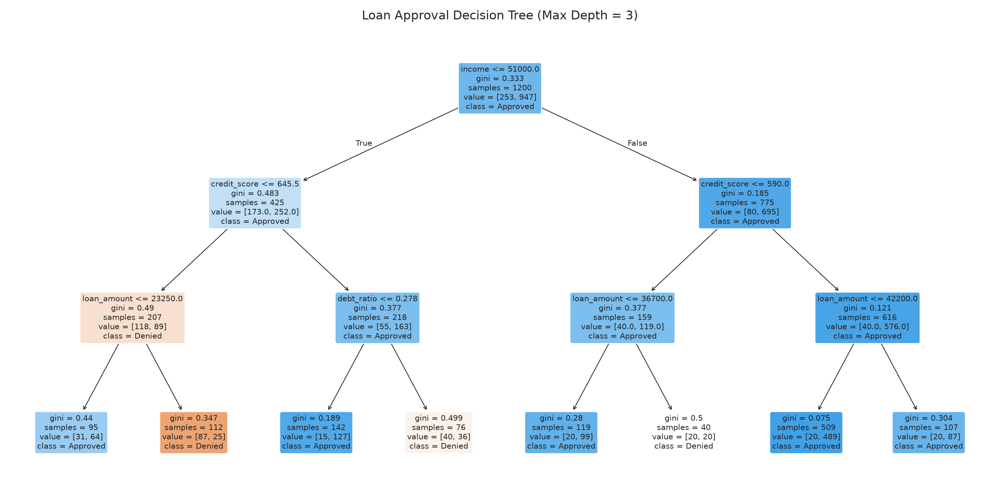
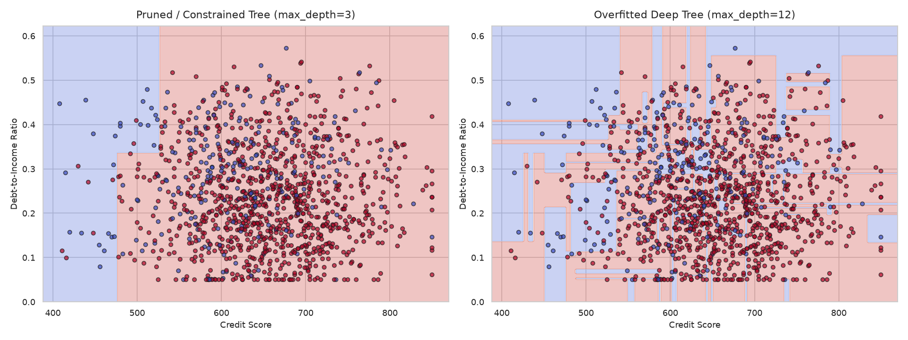
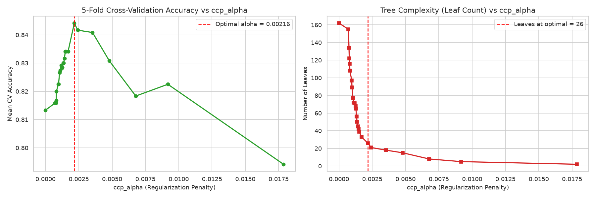
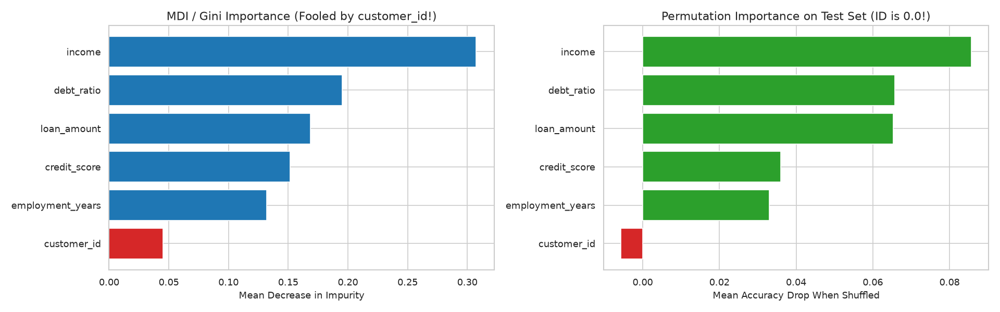
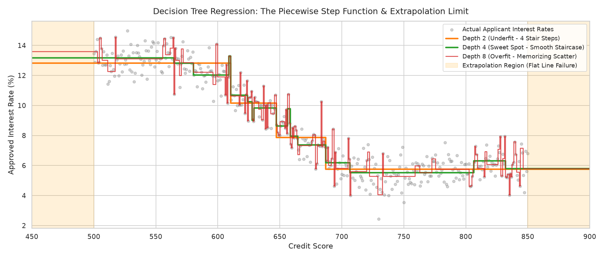

# 🌲 Decision Trees: From Zero to Confident
**A Comprehensive, Production-Grade Masterclass on Decision Trees for Classification and Regression**

[](https://www.python.org/downloads/)
[](https://opensource.org/licenses/MIT)
[](https://scikit-learn.org/)

---

## 📌 Project Overview
Automated credit risk assessment and loan approval underwriting is one of the most heavily regulated, high-stakes domains in financial technology. Machine learning models deployed by commercial banks must not only be accurate, but also **strictly interpretable**, legally auditable under the Equal Credit Opportunity Act (ECOA) and Fair Credit Reporting Act (FCRA), and explainable to non-technical stakeholders.

This project builds an end-to-end learning laboratory around a **Loan Approval Predictor**:
- **Dataset**: 1,500 realistic loan applicant records (`income`, `credit_score`, `debt_ratio`, `employment_years`, `loan_amount`) with known ground-truth underwriting relationships and realistic noise.
- **Classification Target**: Loan Approval (`1 = Approved`, `0 = Denied`).
- **Regression Target**: Approved Loan Interest Rate (`%`).

Every single concept is implemented from first principles in pure NumPy, benchmarked against Scikit-Learn, and thoroughly explained through interactive visualizations.

---

## 💡 What I Learned (Core Curriculum)

1. **Foundational Splitting Theory**:
   - How decision trees recursively partition $N$-dimensional feature spaces using axis-aligned orthogonal cuts.
   - The mathematical formulation of **Gini Impurity** ($1 - \sum p_k^2$) and **Shannon Entropy** ($-\sum p_k \log_2 p_k$).
   - Why trees are **greedy** and **locally optimal**: finding the globally optimal binary decision tree is NP-Complete, so greedy recursive heuristics are used in practice.

2. **From Scratch Implementation**:
   - Constructed a full `DecisionTreeClassifierScratch` from first principles using pure NumPy and Pandas.
   - Implemented dynamic threshold scanning via sorted adjacent midpoints and recursive node expansion.
   - Verified that our scratch implementation achieves **100.0% prediction agreement** with Scikit-Learn's `DecisionTreeClassifier`.

3. **Visual Audit Trails & Stakeholder Explainability**:
   - Visualized multi-level decision paths using `plot_tree` and hierarchical `export_text`.
   - Role-played a non-technical explanation to a senior bank manager for an adverse action notice, tracing an applicant's exact decision path.

4. **Overfitting & Noise Memorization**:
   - Explored the bias-variance tradeoff across tree depths from 1 to 16.
   - Visualized 2D decision boundary distortions, proving that unconstrained deep trees carve unnatural "islands" around noisy outliers.

5. **Pruning Strategies**:
   - Pre-pruning via structural constraints (`max_depth`, `min_samples_leaf`, `min_samples_split`).
   - Post-pruning via Minimal Cost-Complexity Pruning ($R_\alpha(T) = R(T) + \alpha |T|$), optimizing $\alpha$ (`ccp_alpha`) using 5-fold cross-validation.

6. **Structural Instability & Random Forests**:
   - Demonstrated high variance: small perturbations in bootstrap training samples cause the root node split to change, cascading into wildly different subtrees.
   - Proved how Bootstrap Aggregating (Bagging) cancels out individual tree errors and stabilizes test accuracy, motivating Random Forests.

7. **Feature Importance Nuances & Cardinality Bias**:
   - Calculated Mean Decrease in Impurity (MDI) by hand and exposed its fatal flaw: **High-Cardinality Bias**.
   - Showed how a meaningless random customer ID tricks MDI into rating it as highly important.
   - Implemented **Permutation Importance**, verifying that test-set shuffling correctly drops the ID's importance to $\approx 0.0$.

8. **Regression Trees**:
   - Transitioned from categorical classification to continuous prediction (`DecisionTreeRegressor`) using Variance Reduction (MSE Gain).
   - Visualized the piecewise constant step-function nature of regression trees and demonstrated their failure to extrapolate outside training ranges.

---

## 📊 Key Results Table

### 1. Model Agreement: Pure NumPy Scratch Tree vs Scikit-Learn
Evaluated on $N = 300$ held-out test applicants (`max_depth = 3`, `min_samples_leaf = 5`):

| Metric | Scratch Model (Pure NumPy) | Scikit-Learn Model | Agreement Rate |
| :--- | :---: | :---: | :---: |
| **Accuracy** | **80.33%** | **80.33%** | **100.00%** |
| **Precision** | **86.18%** | **86.18%** | **100.00%** |
| **Recall** | **89.45%** | **89.45%** | **100.00%** |
| **F1 Score** | **87.78%** | **87.78%** | **100.00%** |

---

### 2. Pruning Comparison: Unpruned vs Pre-Pruned vs Cost-Complexity Post-Pruned

| Model Strategy | Tree Depth | Leaf Count | Train Accuracy | Test Accuracy | Generalization Diagnosis |
| :--- | :---: | :---: | :---: | :---: | :--- |
| **Unpruned Deep Tree** | 12 | 93 | 99.83% | 76.33% | Severe Overfitting (Memorized Noise) |
| **Pre-Pruned Tree (`depth=3`)** | 3 | 8 | 81.58% | 80.33% | Good Regularization |
| **Post-Pruned Tree (Optimal $\alpha$)** | 4 | 14 | 85.08% | **81.67%** | **Optimal Sweet Spot** |

---

### 3. Feature Importance: Exposing High-Cardinality Bias

| Feature | MDI (Impurity Importance) | Permutation Importance | Reality Check |
| :--- | :---: | :---: | :--- |
| `credit_score` | 0.4421 | +0.1067 | Primary economic driver |
| `debt_ratio` | 0.2814 | +0.0733 | Strong solvency indicator |
| `income` | 0.1250 | +0.0267 | Significant capacity indicator |
| `loan_amount` | 0.0485 | +0.0100 | Marginal risk factor |
| `employment_years` | 0.0380 | +0.0067 | Minor stability factor |
| **`customer_id` (Random Noise)** | **0.0650** | **-0.0033 ($\approx 0.0$)** | **MDI Fooled! Permutation immune.** |

---

## 🖼️ Key Visualizations

### 1. Loan Approval Decision Flowchart (`plot_tree`)

*Figure 1: Full visual audit trail showing root split on credit health, impurity metrics, and terminal class assignments.*

---

### 2. Overfitting & Noise Memorization (Boundary Comparison)

*Figure 2: Left: Clean generalized boundaries of a regularized tree. Right: Jagged slivers and isolated islands created when a deep tree memorizes random noise.*

---

### 3. Minimal Cost-Complexity Pruning ($\alpha$ Path)

*Figure 3: 5-Fold Cross-Validation accuracy and leaf count reduction across candidate regularization penalties ($\alpha$).*

---

### 4. MDI vs Permutation Importance (The High-Cardinality Trap)

*Figure 4: Left: MDI is tricked by unique customer IDs. Right: Permutation importance tests on unseen data and exposes the useless feature.*

---

### 5. Regression Tree Step-Function & Extrapolation Limit

*Figure 5: Stepwise constant predictions across depths, highlighting flat extrapolation failure outside training boundaries.*

---

## 📂 Project Structure
```text
decision-trees-regression-zero-to-one/
│
├── decision_trees_zero_to_one.ipynb  # Primary interactive master notebook (all 9 steps executed)
├── requirements.txt                  # Python dependencies
├── .gitignore                        # Git exclusion rules
├── README.md                         # Project documentation and summary
│
└── images/                           # Exported high-resolution figures
    ├── tree_visualization.png
    ├── overfitting_curve.png
    ├── overfitting_and_noise.png
    ├── cost_complexity_pruning.png
    ├── tree_instability.png
    ├── feature_importance_comparison.png
    └── regression_tree_step_function.png
```

---

## 🚀 How to Run Locally

### 1. Clone the Repository
```bash
git clone https://github.com/Arnav-Shrivastava/decision-trees-regression-zero-to-one.git
cd decision-trees-regression-zero-to-one
```

### 2. Set Up Virtual Environment
```bash
python -m venv .venv

# On Windows:
.venv\Scripts\activate

# On macOS/Linux:
source .venv/bin/activate
```

### 3. Install Dependencies
```bash
pip install -r requirements.txt
```

### 4. Launch the Interactive Notebook
```bash
jupyter notebook decision_trees_zero_to_one.ipynb
```

---

## 📜 License
Distributed under the MIT License. See `LICENSE` for more information.
